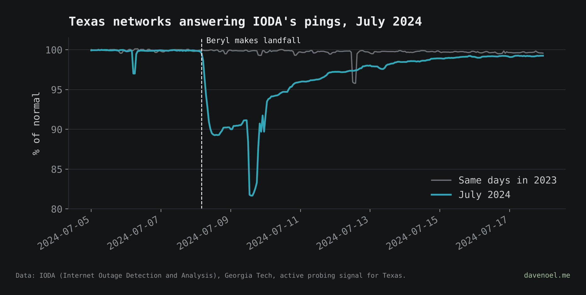
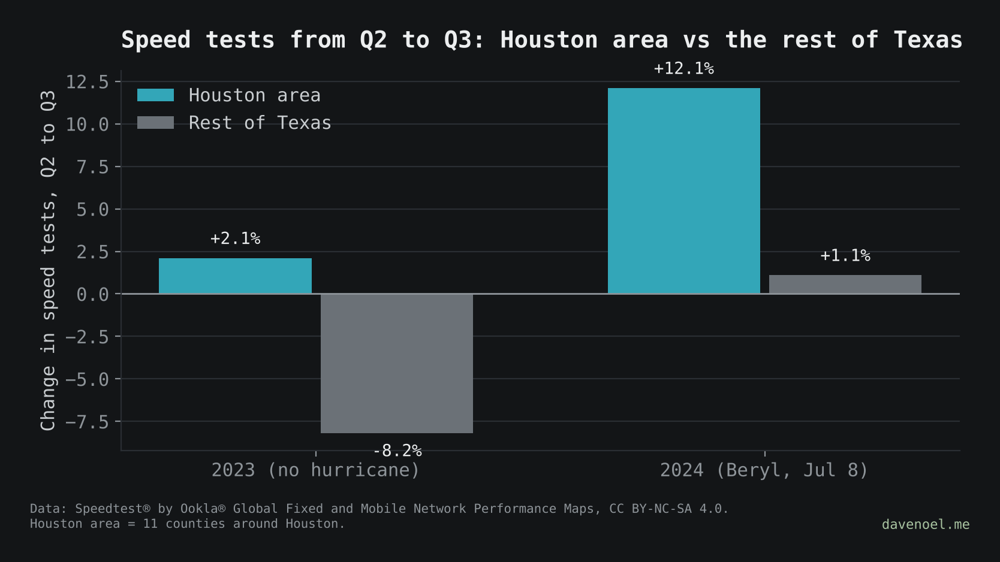

# The data that isn't there: Hurricane Beryl

**Post:** [davenoel.me/stories/the-data-that-isnt-there.html](https://davenoel.me/stories/the-data-that-isnt-there.html)

When Hurricane Beryl knocked out power across the Houston area in July 2024, did the internet notice? Using only public data:

- **Active probing (IODA) saw it clearly.** About 1 in 10 Texas address blocks stopped answering after landfall (4 a.m. Jul 8), and it took a week to get back to 99%. The same days in 2023 stayed flat.
- **Routing (BGP) barely moved.** Networks kept announcing themselves while the people behind them were offline.
- **Quarterly speed test counts can't see it.** Houston-area tests rose 12.1% from Q2 to Q3 2024, but after comparing with the rest of Texas and with 2023, Houston's extra growth is under 1 point.




## Run it

```
pip install -r ../requirements.txt
python3 beryl/fetch_ioda.py                                     # IODA signals, July 2024 + July 2023
python3 tools/fetch_ookla.py 2024 && mv texas_fixed_2024.parquet data/
python3 tools/fetch_ookla.py 2023 && mv texas_fixed_2023.parquet data/
cd beryl && python3 ioda_timeline.py && python3 speedtest_counts.py
```

`fetch_noaa.py` pulls NOAA Storm Events for Texas, July 7–10, 2024. The current NOAA file has no Houston-area entries for Beryl, so it isn't used in the story yet.

| File | What it does |
| --- | --- |
| `fetch_ioda.py` | Downloads IODA's three signals for Texas (10-minute resolution) |
| `ioda_timeline.py` | Percent of normal, hourly medians + 3-hour rolling median, 2024 vs 2023 |
| `speedtest_counts.py` | Q2 to Q3 change in speed tests, Houston area (11 counties) vs rest of Texas, 2023 vs 2024 |
| `fetch_noaa.py` | NOAA Storm Events, Texas, July 7–10, 2024 |

## Caveats

- IODA numbers are statewide; the Houston-area drop was likely deeper.
- A sharp dip on the afternoon of July 9 (to about 82%) may be a measurement blip.
- Houston area = Harris, Fort Bend, Montgomery, Brazoria, Galveston, Waller, Liberty, Chambers, Matagorda, Wharton and Austin counties.

## Sources

- IODA: Internet Outage Detection and Analysis, Georgia Tech. https://ioda.inetintel.cc.gatech.edu
- Speedtest® by Ookla® Global Fixed and Mobile Network Performance Maps, fixed tiles, 2023 and 2024. Based on analysis by Ookla of Speedtest Intelligence® data. CC BY-NC-SA 4.0. https://registry.opendata.aws/speedtest-global-performance
- County boundaries: US Census Bureau cartographic boundary file, via plotly/datasets.
- NOAA NCEI Storm Events Database (not used in the story yet).
