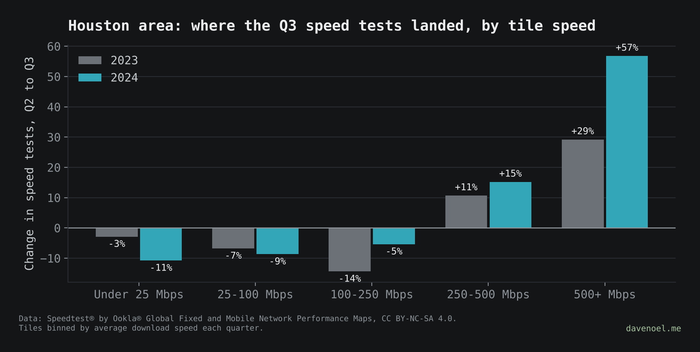
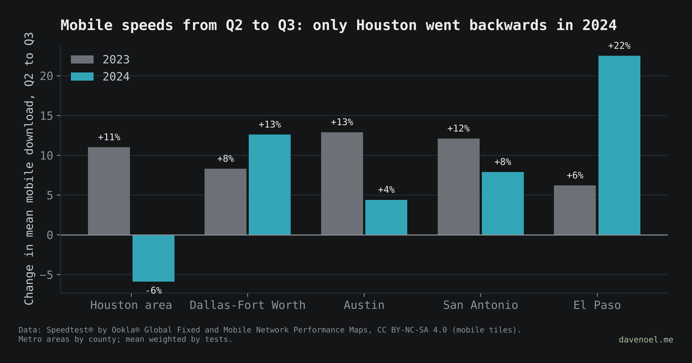

# The data that isn't there: Hurricane Beryl

**Post:** [davenoel.me/stories/the-data-that-isnt-there.html](https://davenoel.me/stories/the-data-that-isnt-there.html)

When Hurricane Beryl knocked out power across the Houston area in July 2024, did the internet notice? Using only public data:

- **Active probing (IODA) saw it clearly.** About 1 in 10 Texas address blocks stopped answering after landfall (4 a.m. Jul 8), and it took a week to get back to 99%. The same days in 2023 stayed flat.
- **Routing (BGP) barely moved.** Networks kept announcing themselves while the people behind them were offline.
- **Mobile speeds did notice.** The Houston area was the only big Texas metro where average mobile download fell from Q2 to Q3 2024 (-6%, after +11% in 2023), while Dallas-Fort Worth, Austin, San Antonio and El Paso all got faster. Congestion and storm-damaged cell sites both slow mobile down, and this data can't separate them. (Updated Oct 16, 2026: one ~600 m tile in Tarrant County held over half of Dallas-Fort Worth's mobile tests in 2023, so tiles holding more than 10% of a metro's tests in a quarter are now left out. Only the Dallas-Fort Worth numbers change, from +8%/+13% to +12%/+12%.)
- **Quarterly fixed speed test counts can't see it.** Houston-area tests rose 12.1% from Q2 to Q3 2024, but after comparing with the rest of Texas and with 2023, Houston's extra growth is under 1 point. Split by tile speed, the slow bins shrank faster than in 2023 and the growth was at the fast end, so there's no sign of storm-slowed connections either.





## Run it

```
pip install -r ../requirements.txt
python3 beryl/fetch_ioda.py                                     # IODA signals, July 2024 + July 2023
python3 tools/fetch_ookla.py 2024 && mv texas_fixed_2024.parquet data/
python3 tools/fetch_ookla.py 2023 && mv texas_fixed_2023.parquet data/
python3 tools/fetch_ookla.py 2024 mobile && mv texas_mobile_2024.parquet data/
python3 tools/fetch_ookla.py 2023 mobile && mv texas_mobile_2023.parquet data/
cd beryl && python3 ioda_timeline.py && python3 speedtest_counts.py && python3 mobile_vs_metros.py
```

`fetch_noaa.py` pulls NOAA Storm Events for Texas, July 7–10, 2024. The current NOAA file has no Houston-area entries for Beryl, so it isn't used in the story yet.

`fetch_dirs.py` grabs the FCC's daily Beryl status reports (PDFs) and pulls the "cell sites out of service by county" table into one CSV. If fcc.gov won't talk to a script, save the PDFs from https://www.fcc.gov/beryl in your browser and run `python3 beryl/fetch_dirs.py --pdf path/to/*.pdf`. Not used in the story yet; it's here so the cell-site side of "phones picked up the slack" can be checked against the FCC's own numbers.

| File | What it does |
| --- | --- |
| `fetch_ioda.py` | Downloads IODA's three signals for Texas (10-minute resolution) |
| `ioda_timeline.py` | Percent of normal, hourly medians + 3-hour rolling median, 2024 vs 2023 |
| `speedtest_counts.py` | Q2 to Q3 change in speed tests, Houston area (11 counties) vs rest of Texas, 2023 vs 2024, plus Houston by tile speed bin |
| `mobile_vs_metros.py` | Mobile tests and average download, Q2 to Q3, Houston area vs four other Texas metros, 2023 vs 2024 |
| `fetch_noaa.py` | NOAA Storm Events, Texas, July 7–10, 2024 |
| `fetch_dirs.py` | FCC DIRS status reports for Beryl: cell sites out of service by county, per day |

## Caveats

- IODA numbers are statewide; the Houston-area drop was likely deeper.
- A sharp dip on the afternoon of July 9 (to about 82%) may be a measurement blip.
- Houston area = Harris, Fort Bend, Montgomery, Brazoria, Galveston, Waller, Liberty, Chambers, Matagorda, Wharton and Austin counties.

## Data

What's in the box, so you know what each number can and can't tell you:

| Dataset | What it counts | Grain | Where it lands | License / credit |
| --- | --- | --- | --- | --- |
| IODA (Georgia Tech) | /24 address blocks answering pings, BGP prefixes announced, telescope traffic | Texas statewide, every 10 minutes | `data/beryl/ioda_texas_*.csv` | Free for research; credit IODA |
| Ookla open data, fixed and mobile | Average download/upload/latency and number of tests per ~600 m tile | Quarter | `data/texas_{fixed,mobile}_{2023,2024}.parquet` | CC BY-NC-SA 4.0 |
| FCC DIRS status reports | Cell sites served and out of service, by county | Daily, July 2024 | `data/beryl/fcc_dirs_cell_sites_tx_2024-07.csv` | US government work, public domain; credit the FCC |
| NOAA Storm Events | Weather events by county with times and damage | Event | `data/beryl/noaa_storm_events_tx_2024-07.csv` | US government work, public domain; credit NOAA NCEI |
| Census county boundaries | Texas county shapes for the tile-to-county join | County | downloaded on the fly | US government work, public domain |

Nothing in `data/` is committed. Run the fetch scripts and it all comes back.

## Sources

- IODA: Internet Outage Detection and Analysis, Georgia Tech. https://ioda.inetintel.cc.gatech.edu
- Speedtest® by Ookla® Global Fixed and Mobile Network Performance Maps, fixed and mobile tiles, 2023 and 2024. Based on analysis by Ookla of Speedtest Intelligence® data. CC BY-NC-SA 4.0. https://registry.opendata.aws/speedtest-global-performance
- County boundaries: US Census Bureau cartographic boundary file, via plotly/datasets.
- NOAA NCEI Storm Events Database (not used in the story yet). https://www.ncdc.noaa.gov/stormevents/
- FCC Disaster Information Reporting System (DIRS), Communications Status Reports for Areas Impacted by Hurricane Beryl, July 2024 (not used in the story yet). https://www.fcc.gov/beryl
