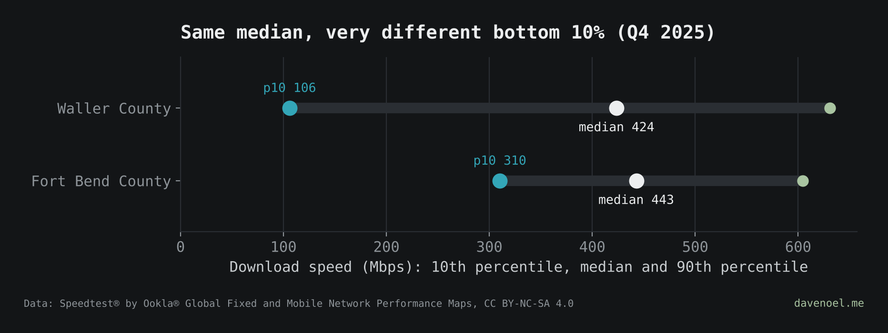
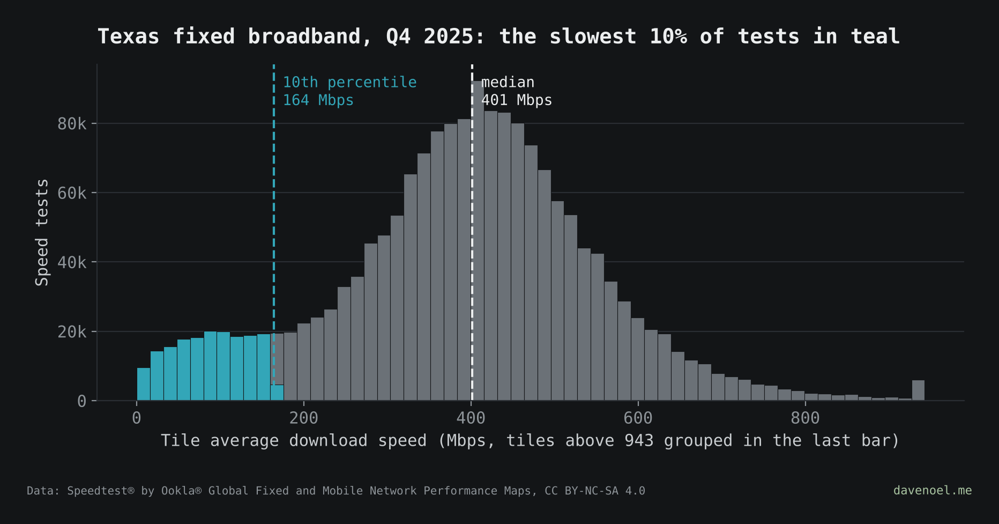

# Percentiles: the 10th tells you who's suffering

**Post:** [davenoel.me/notes/percentiles.html](https://davenoel.me/notes/percentiles.html)

The post uses a made-up Town A and Town B: same median, very different 10th percentile. This folder finds the real thing in Texas.

**Q4 2025:** Fort Bend and Waller counties sit right next to each other west of Houston, and their medians are within 5% (443 vs 424 Mbps). Their 10th percentiles are 310 vs 106 Mbps. The median says they're the same. The bottom 10% says they really aren't.



Texas as a whole, Q4 2025: 10th percentile 164 Mbps, median 401 Mbps.



## Run it

```
pip install -r ../requirements.txt
python3 ../tools/fetch_ookla.py 2025 && mv texas_fixed_2025.parquet ../data/
cd ../sql-or-python && python3 prep.py      # tile centroid -> Texas county (shared step)
cd ../percentiles && python3 percentiles.py
```

Writes `../data/tx_percentiles_2025.csv` (Texas, by quarter), `../data/tx_county_percentiles_q4_2025.csv` (every county with 2,000+ tests) and the two charts in `charts/`.

## What these numbers are (and aren't)

Ookla's open data comes as ~600 m tiles. Each tile has the *average* of the tests inside it and a test count, not the individual tests. So the percentiles here are test-weighted percentiles of tile averages: line the tiles up slowest to fastest, count tests as you go, and stop at 10% (or 50%, or 90%) of all tests.

That's close to the percentile of individual tests, but not the same. Averaging inside a tile smooths out the extremes, so the true 10th percentile of tests is probably lower than what's shown here. The comparison between counties still holds, since both get the same treatment.

## Sources

- Speedtest® by Ookla® Global Fixed and Mobile Network Performance Maps, fixed tiles, 2025 Q1–Q4. Based on analysis by Ookla of Speedtest Intelligence® data. [registry.opendata.aws/speedtest-global-performance](https://registry.opendata.aws/speedtest-global-performance). CC BY-NC-SA 4.0. Ookla trademarks used under license and reprinted with permission.
- County boundaries: US Census Bureau 2010 cartographic boundary file (500k), via [plotly/datasets](https://github.com/plotly/datasets).

Data is reaggregated by Ookla from time to time, so a rerun on a later date can shift numbers slightly.
