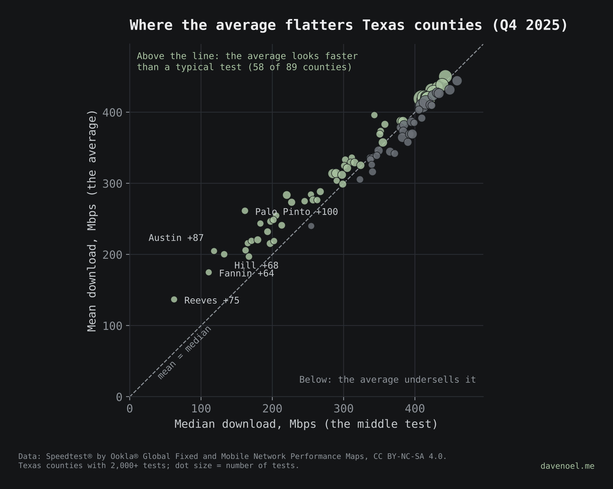
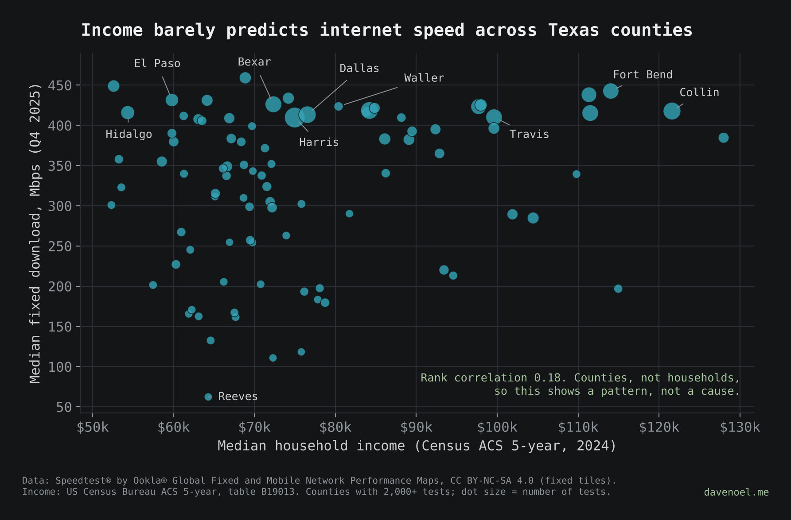

# Averages lie: Texas edition

**Post:** publishes Dec 2, 2026 on [davenoel.me](https://davenoel.me) (link added when it's live). Follows [Averages lie](https://davenoel.me/notes/averages-lie.html).

Mean vs median fixed download speed for every Texas county with 2,000+ speed tests in Q4 2025.



## What turned up

- **Statewide, the average actually undersells Texas a little:** mean 392 Mbps, median 401 Mbps.
- **County by county, it's the other way around.** In 58 of 89 counties the average beats the median, and the biggest gaps are all smaller, more rural counties: Palo Pinto (+100 Mbps), Austin (+87), Reeves (+75), Hill (+68) and Fannin (+64). A few fast connections pull the average up while the typical test stays slow.
- **The big metros sit almost on the line.** Lots of tests, lots of fast connections, and the two numbers agree.
- Reeves comes with an asterisk: one very busy tile dominates its tests (see [`sql-or-python/`](../sql-or-python/)).

## Run it

```
pip install -r ../requirements.txt
python3 ../tools/fetch_ookla.py 2025 && mv texas_fixed_2025.parquet ../data/
cd ../sql-or-python && python3 prep.py      # tile centroid -> Texas county (shared step)
cd ../texas-averages && python3 texas_averages.py
```

Writes `../data/tx_county_mean_median_q4_2025.csv` and the chart in `charts/`.

## Part 2: speed vs income

Does a county's median household income line up with its median download speed? Run this after the steps above:

```
python3 fetch_census.py          # Census ACS 5-year median household income, Texas counties
python3 speed_vs_income.py
```



What turned up (89 counties with 2,000+ tests, ACS 5-year 2024):

- **The link is weak.** Rank correlation between median household income and median download is 0.18.
- **Some of the lowest-income counties are among the fastest.** Cameron ($52,601) and Hidalgo ($54,338) have medians of 449 and 416 Mbps.
- **The slowest counties are middle income, not the poorest.** Reeves (62 Mbps), Fannin (111) and Austin (118) sit between $64k and $76k.
- The richest suburbs are fast (Fort Bend, $114,041, 443 Mbps), but so is a lot of everywhere else.

`fetch_census.py` needs nothing but python3 and a free [Census API key](https://api.census.gov/data/key_signup.html) set with `export CENSUS_API_KEY=...` (keep it out of the repo). Writes `../data/tx_county_income_acs<YEAR>.csv` (2024, or the newest release that answers), `../data/tx_county_speed_income.csv` and `charts/speed-vs-income.{svg,png}`.

This compares counties, not households. A rural county can be both lower income and slower to get fiber without one causing the other, so read it as a pattern, not a cause.

## What these numbers are

- **Mean** is exact: each tile's average speed times its test count, summed, divided by all tests.
- **Median** is the middle test, approximated from tile averages (test-weighted; same method as [`percentiles/`](../percentiles/)).

## Sources

- Speedtest® by Ookla® Global Fixed and Mobile Network Performance Maps, fixed tiles, Q4 2025. Based on analysis by Ookla of Speedtest Intelligence® data. [registry.opendata.aws/speedtest-global-performance](https://registry.opendata.aws/speedtest-global-performance). CC BY-NC-SA 4.0. Ookla trademarks used under license and reprinted with permission.
- Median household income: US Census Bureau, American Community Survey 5-year estimates, table B19013, via the [Census Data API](https://www.census.gov/data/developers.html).
- County boundaries: US Census Bureau 2010 cartographic boundary file (500k), via [plotly/datasets](https://github.com/plotly/datasets).
